<div align="center">


# Invisiko

**The back of house, on one phone.**

Staff hours, food-safety records, pay and delivery invoices — for independent takeaways and small restaurants.

[Website](https://invisiko.app) · [Features](https://invisiko.app/features) · [How it works](https://invisiko.app/how-it-works) · [Request access](https://invisiko.app/contact) · [Support](https://invisiko.app/support)


<br />

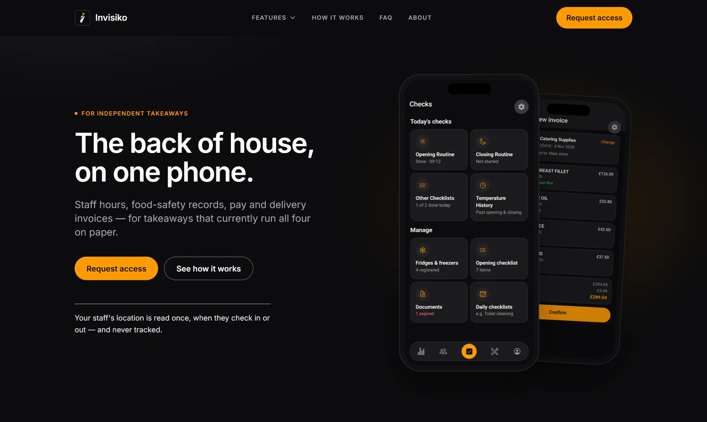

</div>

---

## About this repository

This repository holds the **marketing website for Invisiko** — [invisiko.app](https://invisiko.app). The website is
deliberately separate from the Invisiko app: it has no access to the app, its API or any restaurant's data, and its
only integrations are outbound links and its own request-access form.

> The website code lives in [`website/`](website). For setup, decisions and the launch checklist in detail, see
> [`website/README.md`](website/README.md).

## What Invisiko does

Invisiko is an **iPhone app** that runs the back of house for an independent takeaway or small restaurant. Managers
and staff use the same app; each sees what their role allows.

| | |
|---|---|
| **Attendance & rota** | Staff check in by scanning a QR code at the door. The phone's position is checked against a radius the manager sets, and a check-in from outside it is refused. Weekly rota with live cost, shift swaps with approval. |
| **Food-safety records** | Opening and closing routines, fridge and freezer temperatures, and named checklists — each recorded with who and when. Licences and certificates filed with expiry dates, for managers only. |
| **Invoice scanning** | Photograph a delivery note or upload the PDF. Lines are read automatically and matched to stock — and nothing reaches stock until a person confirms it. |
| **Pay** | Fortnightly pay periods built from recorded hours, with per-person rates. Closed periods stay correct when a rate changes. |

**What it isn't:** a till or ordering system; a multi-site tool (one restaurant per account); or an offline app — it
needs a connection.

## The app

<div align="center">

<table>
  <tr>
    <td align="center" width="25%">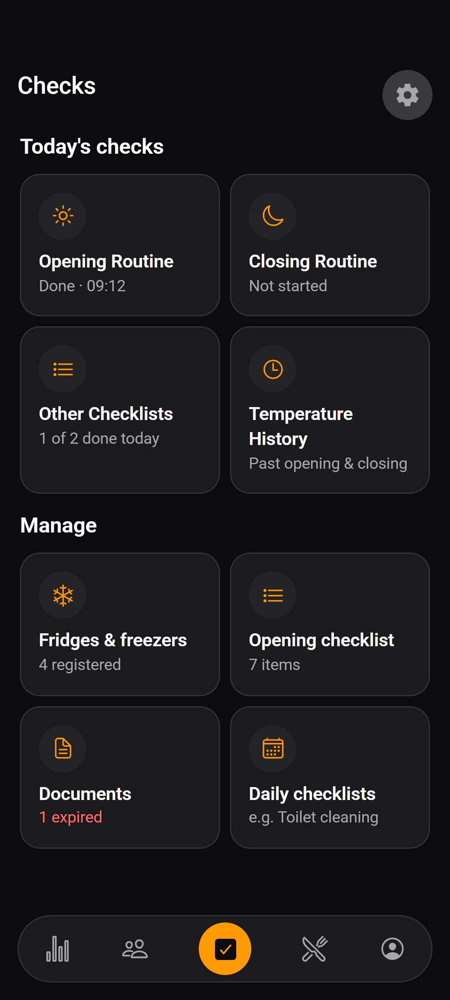<br /><sub><b>Checks dashboard</b></sub></td>
    <td align="center" width="25%">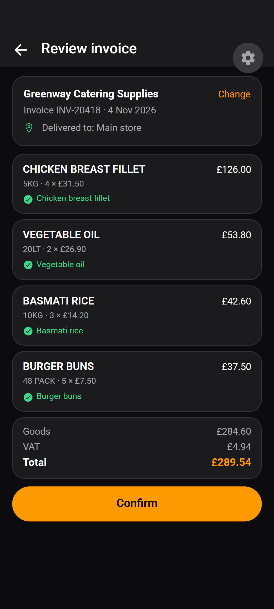<br /><sub><b>Invoice review</b></sub></td>
    <td align="center" width="25%">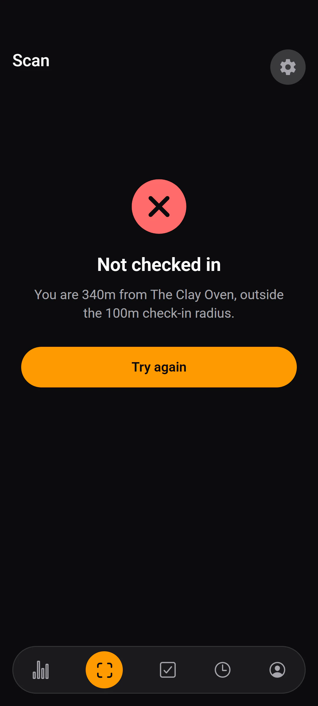<br /><sub><b>Check-in refused</b></sub></td>
    <td align="center" width="25%">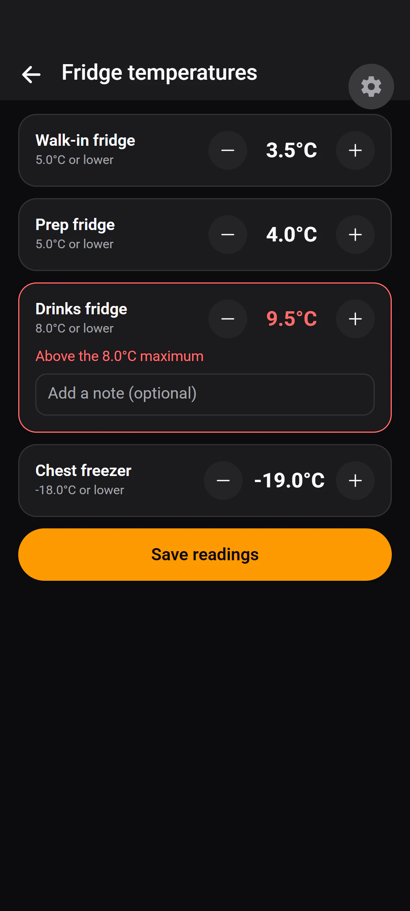<br /><sub><b>Fridge temperatures</b></sub></td>
  </tr>
  <tr>
    <td align="center">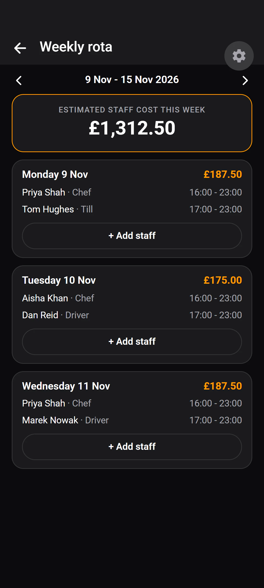<br /><sub><b>Weekly rota</b></sub></td>
    <td align="center">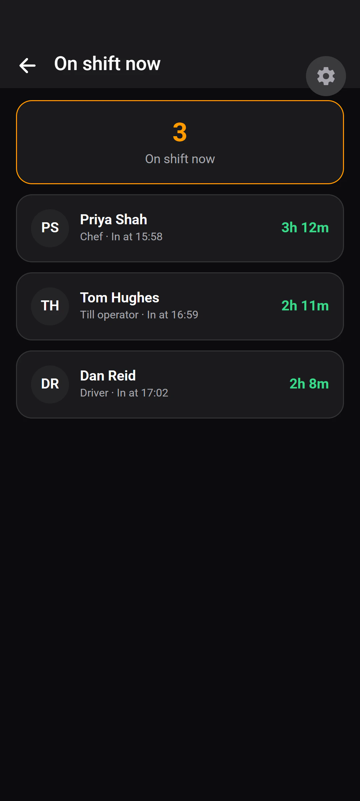<br /><sub><b>On shift now</b></sub></td>
    <td align="center">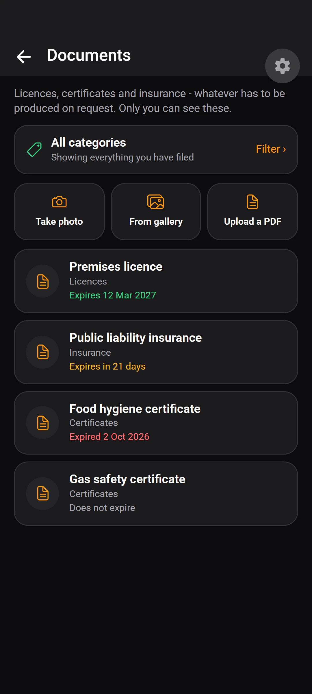<br /><sub><b>Documents</b></sub></td>
    <td align="center">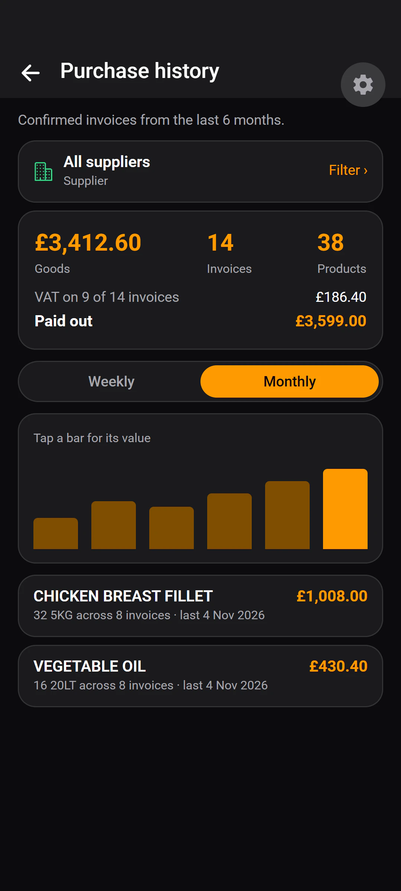<br /><sub><b>Purchase history</b></sub></td>
  </tr>
</table>

<sub>Screens show demo data for a fictional restaurant, The Clay Oven.</sub>

</div>

## The website

<table>
  <tr>
    <td width="68%">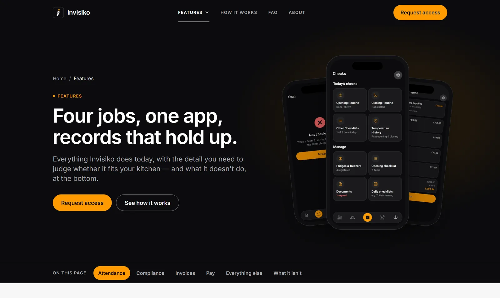</td>
    <td width="32%" rowspan="2" valign="top">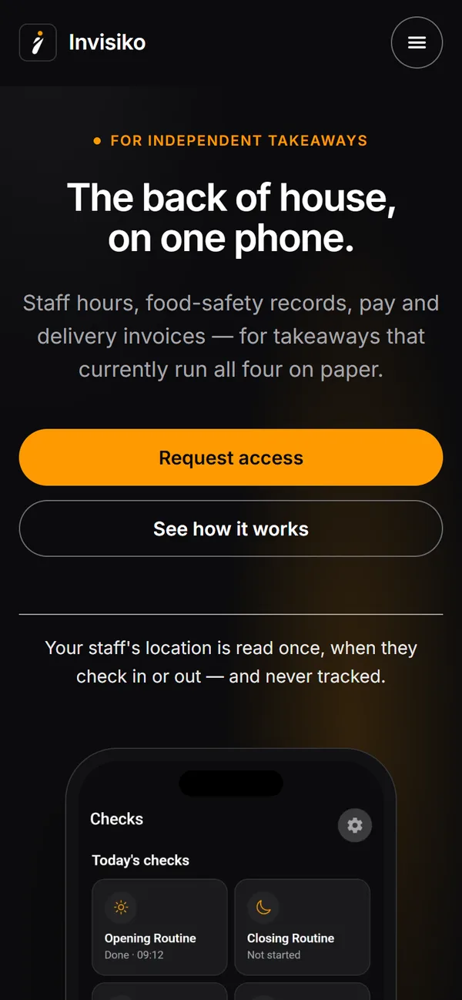</td>
  </tr>
  <tr>
    <td>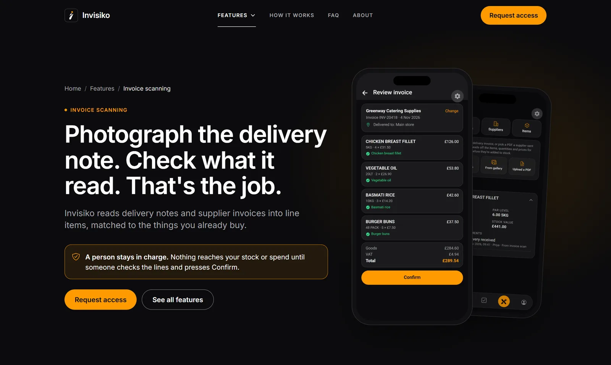</td>
  </tr>
</table>

**Pages:** Home · Features · Invoice scanning · Attendance & rota · Compliance records · How it works · About ·
Contact · FAQ · Privacy · Terms · Support

**Highlights**

- **Built for the people who use it** — owner-managers on a phone between services. Mobile-first, from 320px to 1920px.
- **Honest by design** — every product claim maps to a built feature; limits are stated up front; a test fails if the
  copy promises anything the app doesn't do.
- **Scroll-driven motion** — native CSS scroll timelines for reveals, a phone that follows each step of a timeline,
  and hero phones that fan out — all switched off under *reduce motion*.
- **Accessible** — semantic landmarks, visible focus, keyboard-operable menus and accordions, WCAG A/AA checked with axe.
- **Findable** — per-page metadata, structured data (WebSite, WebPage, BreadcrumbList, SoftwareApplication, FAQPage,
  HowTo), a sitemap, and [`/llms.txt`](https://invisiko.app/llms.txt) so AI assistants describe Invisiko accurately.
- **Private by default** — no cookies, no analytics, no trackers. The request-access form emails the team over SMTP
  and stores nothing.

## Tech stack

| | |
|---|---|
| Framework | [Next.js 16](https://nextjs.org) (App Router), React 19, TypeScript — statically generated |
| Styling | [Tailwind CSS 4](https://tailwindcss.com), with the app's own colour palette as design tokens |
| Icons & type | [Ionicons](https://ionic.io/ionicons) via `react-icons`, [Inter](https://rsms.me/inter/) self-hosted |
| Email | [Nodemailer](https://nodemailer.com) over SMTP, from a server-only route |
| Testing | [Vitest](https://vitest.dev) + Testing Library, [Playwright](https://playwright.dev) + [axe](https://github.com/dequelabs/axe-core) |
| Images | `sharp` for brand assets and app screens, `next/image` for delivery |

## Getting started

Requires **Node.js 20+**.

```bash
cd website
npm install
cp -n .env.example .env.local # -n never overwrites; fill in .env.local, never .env.example
npm run dev                   # http://localhost:3000
```

| Command | What it does |
|---|---|
| `npm run dev` | Development server |
| `npm run build` · `npm run start` | Production build, and serve it |
| `npm run lint` · `npm run typecheck` | ESLint and TypeScript |
| `npm test` | Unit tests |
| `npm run test:e2e` | Playwright smoke suite with accessibility checks (build first) |
| `npm run demo-screens` | Re-render the app's demo screens |
| `npm run brand` | Rebuild icons from the logo |

### Environment variables

Secrets go in `website/.env.local` (ignored by Git) and in the hosting provider's settings — **never in
`.env.example`**, which is committed. A test fails if a password is pasted there.

| Variable | Purpose |
|---|---|
| `SMTP_HOST`, `SMTP_PORT`, `SMTP_USER`, `SMTP_PASS` | The mailbox the request-access form sends through. Until they are set, the form fails politely and shows the support address. |
| `CONTACT_TO_EMAIL`, `CONTACT_FROM_EMAIL` | Optional. Default to the SMTP mailbox. |
| `NEXT_PUBLIC_SITE_URL` | Canonical host. Defaults to `https://invisiko.app`. |
| `NEXT_PUBLIC_APP_STORE_URL` | The App Store listing. The badge appears once it is set. |
| `NEXT_PUBLIC_GOOGLE_SITE_VERIFICATION`, `NEXT_PUBLIC_BING_SITE_VERIFICATION` | Search console ownership tokens. |

## Project structure

```
.
├── docs/images/            README screenshots
└── website/
    ├── app/                pages, metadata, sitemap, robots, llms.txt, the contact route
    ├── components/         header, footer, phone frame, step showcase, legal layout, …
    ├── sections/           page-specific visuals: hero phones, invoice pipeline, FAQ cards
    ├── content/            copy and facts as typed data — edit here, not in components
    ├── lib/                metadata, structured data, validation, email
    ├── scripts/            demo screens, brand assets, screenshot clean-up
    ├── public/             screenshots and brand images
    └── tests/              unit tests and the Playwright smoke suite
```

## Deployment

Built for [Vercel](https://vercel.com): import the repository, set the **root directory to `website`**, add the
environment variables above, and point `invisiko.app` at the project. Preview deployments are kept out of search
engines automatically.

## Contact

Questions about the app or this website: **[support@invisiko.app](mailto:support@invisiko.app)**

---

<div align="center">
<sub>© 2026 Invisiko · London, UK. All rights reserved.</sub>
</div>
